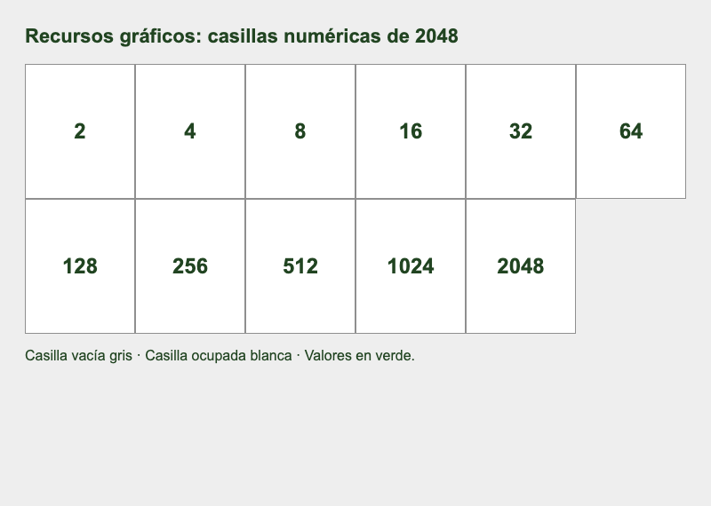
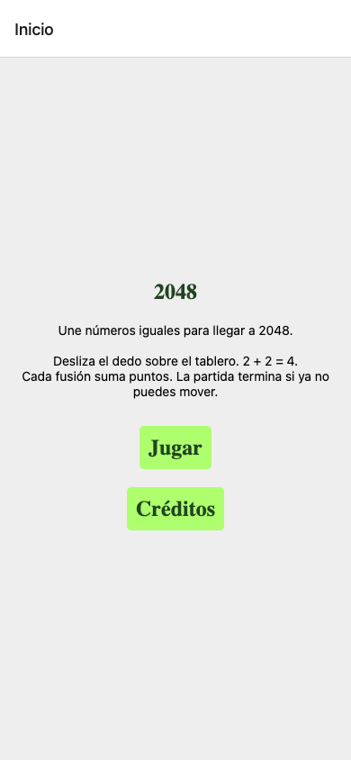
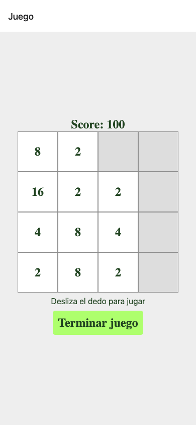
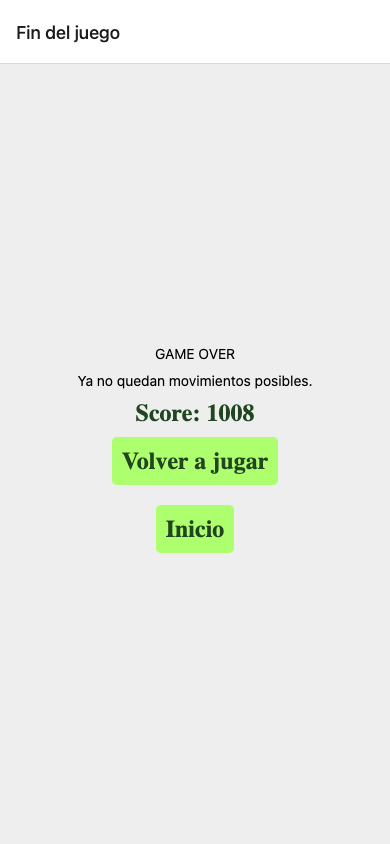
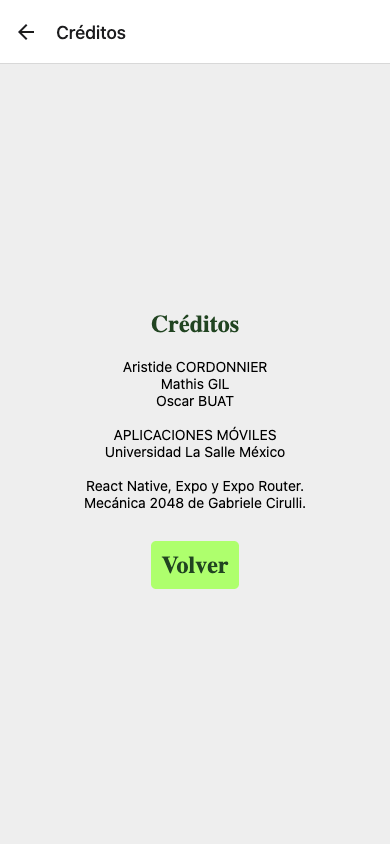

# Reporte de práctica: 2048

Universidad La Salle México · APLICACIONES MÓVILES

Aristide CORDONNIER · Mathis GIL · Oscar BUAT

11 de octubre de 2026

REPORTE DE PRÁCTICA

AsignaturaAPLICACIONES MÓVILES

IntegrantesAristide CORDONNIERMathis GILOscar BUAT

InstituciónUniversidad La Salle México

Fecha11 de octubre de 2026

React Native · Expo SDK 57 · Expo Router

## 1. Objetivo y preparación

Aplicar los conceptos de programación con React Native y Expo para desarrollar una aplicación móvil de entretenimiento. Se implementa un 2048 sencillo con navegación, estado, gestos y puntuación, manteniendo una interfaz consistente.

### Material y equipo

Base de clase en el proyecto test-2026-2, computadora con Node.js, React Native 0.86.3, React 19.2.3, Expo 57.0.27 y Expo Router 57.0.25. Para verificar se utilizaron TypeScript, ESLint, Node Test y Chromium. La demostración requiere un teléfono físico con Expo Go compatible con SDK 57 y conexión a Metro.

### Marco teórico

React Native construye la interfaz con componentes como View, Text y Pressable. useState conserva el tablero y los puntos. useEffect comprueba si la partida terminó después de un cambio. Expo facilita ejecutar el proyecto y generar bundles. Expo Router organiza las pantallas a partir de los archivos de src/app. [1, 2]

### Desarrollo experimental: procedimiento

1. Revisar la base existente y conservar el tablero de 4 × 4. Se elige 2048. No se implementa Match-3.

2. Completar la presentación, el juego, Game Over y los créditos mediante Expo Router.

3. Mantener las reglas en src/utils/board.ts y la representación de una casilla en Cell. Compartir los estilos de los cuatro screens.

4. Inicializar dos fichas aleatorias. Implementar los deslizamientos y añadir el score y el fin automático.

5. Ejecutar pruebas de lógica y de interfaz. Capturar cada pantalla y generar este reporte.

Pantalla

Ruta

Función

Presentación

/

Nombre, propósito, instrucciones y acceso al juego

Juego

/game

Tablero, puntuación, gestos y salida

Game Over

/gameover

Resultado y nueva partida

Créditos

/credits

Integrantes y tecnologías

## 2. Recursos y reglas del juego

Los recursos de las celdas son gráficos sencillos: cuadrados de color con números. No se descargan imágenes ni se usan emojis. Se conserva la apariencia de la base de clase: fondo gris, casillas vacías grises, casillas ocupadas blancas y números verdes.

Figura 1. Muestra de los once niveles definidos en src/components/cell.tsx. No es una partida.

### Justificación de los gráficos

La forma cuadrada corresponde a una celda del tablero y se dibuja con View. El número visible identifica la característica de cada ficha y su nivel: 2, 4, 8 y las siguientes potencias de dos. El blanco distingue las casillas ocupadas del gris de las vacías. Se conserva el recurso numérico original para mantener el código de dibujo sencillo. Esto cumple la función gráfica con pocos recursos y sin complicar el código.

### Lógica de fusión y puntuación

0 representa una casilla vacía. Se quitan los ceros, se unen vecinos iguales una sola vez y se completa la línea con ceros. Por ejemplo, [2, 0, 2, 4] -> [4, 4, 0, 0] suma 4 puntos. La línea [2, 2, 2, 2] -> [4, 4, 0, 0] suma 8. Los movimientos verticales procesan columnas. El mismo cálculo sirve para las cuatro direcciones.

Solo un movimiento que cambia el tablero añade una ficha: 2 con probabilidad del 90 % o 4 con el 10 %. Mover sin fusionar no suma puntos. La partida termina cuando no hay espacios vacíos ni vecinos iguales horizontales o verticales. También se puede terminar voluntariamente.

## 3. Capturas: presentación y juego

Capturas reales de la versión Expo Web en Chromium, a 390 × 844 píxeles. Los gestos se simularon para las pruebas. Estas imágenes no acreditan una prueba física con Expo Go.

Muestra el nombre, el propósito y las instrucciones. Jugar abre la partida. Créditos permite conocer al equipo.

Muestra una partida con 100 puntos. Se juega deslizando el dedo. Al soltarlo se aplica un solo movimiento. Terminar juego abre el resultado.

## 4. Capturas: Game Over y créditos

Fin automático de la sesión de prueba: 1008 puntos, después de 118 deslizamientos y cuatro gestos simulados. Volver a jugar crea una partida nueva.

Incluye a Aristide CORDONNIER, Mathis GIL y Oscar BUAT, la asignatura, la institución y la referencia a la mecánica original.

## 5. Análisis de resultados

La lógica, el desplazamiento por gesto y la navegación se comprobaron localmente. La sesión web fue reproducible con una semilla de prueba de 2048, sin inyectar un tablero final. El recibo de resultados está en rendu/verificacion-web.json. Las capturas conservan la presentación original: gris, blanco y botones verdes.

Problema observado

Solución o límite

Score fijo en cero y tablero vacío al abrir el juego

Inicializar dos fichas y sumar el valor de cada fusión al score.

Faltaban presentación completa y créditos

Completar las cuatro pantallas y compartir estilos.

Riesgo de fusionar una ficha dos veces o crear fichas en movimientos bloqueados

Consumir cada pareja una vez y añadir una ficha solo si el tablero cambió.

Paquetes Expo con cinco versiones de parche diferentes a las recomendadas

Actualizar con expo install --fix. Expo Doctor pasa 21/21 controles.

La exportación web estática creaba una diferencia entre tableros aleatorios de servidor y navegador

Usar salida web single: el juego se inicializa en el navegador. Se comprueba la exportación nuevamente.

### Pruebas realizadas

Lógica: 16 pruebas de Node Test aprobadas. Incluyen cuatro direcciones, puntuación, fichas aleatorias, vecinos que permiten seguir jugando, umbral de gestos y 625 combinaciones de líneas.

Interfaz: 12 controles web aprobados: cuatro gestos simulados, toque corto ignorado, puntuación, fin automático, salida voluntaria, reinicio y navegación. Las cuatro pantallas no desbordan horizontalmente en 320, 390, 430 y 1024 píxeles.

Herramientas: TypeScript y lint sin errores. Expo Doctor 21/21. Exportación de bundles para Android, iOS y web. Esto verifica generación de código, no instalación en un teléfono.

Límite: la prueba física en Expo Go y la demostración en clase están pendientes. El equipo debe confirmar los gestos, la conexión por QR y los márgenes en su dispositivo.

Dependencias: npm audit informa 29 avisos (11 moderados y 18 altos) en la cadena Expo/React Native. No se aplicó audit fix --force porque propone versiones incompatibles con el SDK. Es una limitación pendiente. Expo Doctor no es una auditoría de seguridad.

## 6. Mejoras a futuro: tablero web

Se propone un ranking mediante API. Es un diseño conceptual: esta aplicación no tiene servidor, cuentas ni envío de puntuaciones. El principio es que el servidor valide la partida y calcule el score, en lugar de confiar en un número enviado por la app. [5]

Inicio

Resultado

Ranking

POST /partidas

POST /partidas/{id}/resultado

GET /ranking

Servidor crea una sesión ligada al usuario.

Servidor verifica movimientos y calcula puntos.

Se muestran solo resultados aceptados.

### Lógica propuesta

1. Identidad y transporte. Usar HTTPS y una sesión de usuario autenticada. El servidor obtiene la identidad de un token validado. No acepta un userId arbitrario del cuerpo de la petición.

2. Inicio controlado. El servidor crea un identificador de partida, una semilla aleatoria, la versión de reglas y una expiración. Conserva esos datos ligados a la cuenta. Cliente y servidor usan el mismo generador determinista para crear fichas.

3. Historial verificable. La app conserva direcciones y números consecutivos de movimiento. Al terminar envía ese historial, no un score que el servidor deba aceptar. Se limitan el tamaño del cuerpo y la cantidad de movimientos.

4. Validación del servidor. Se reproduce la partida desde la semilla almacenada, con las reglas oficiales. Se rechazan direcciones inválidas, secuencias repetidas o alteradas, sesiones expiradas y resultados inconsistentes. El score se vuelve a calcular.

5. Evitar repetición y abuso. Guardar el resultado y cerrar la sesión en una transacción. Un índice único sobre la partida impide insertarla dos veces. Limitar solicitudes por cuenta e IP, usar consultas parametrizadas y registrar rechazos sin guardar secretos.

6. No poner una clave secreta en la app. Una clave incorporada en el cliente se puede extraer. Si se firma un comprobante de partida, la clave permanece en el servidor. Validar también autorización, firma y expiración de los tokens.

Límite de la propuesta: HTTPS y autenticación no prueban que una persona haya jugado. Un bot puede producir una secuencia válida. La reproducción reduce la falsificación de scores. Los controles de velocidad, puntos de verificación y revisión de resultados anómalos reducen el abuso, sin garantizar un sistema infalible.

## 7. Conclusiones y entrega

React Native y Expo permiten construir una interfaz móvil pequeña con componentes reutilizables y probar cambios rápidamente. Expo Router facilita organizar la navegación en archivos. Para un tablero de dieciséis celdas, una matriz de números y un estado React son suficientes.

Las dificultades principales están en no modificar el estado anterior, evitar dobles fusiones, usar el estado más reciente y distinguir una prueba web de una prueba móvil. Los gestos también exigen elegir el eje dominante y evitar que las casillas intercepten el dedo.

Se eligió no añadir animaciones personalizadas a las fichas para conservar un código sencillo. Las transiciones entre pantallas las gestiona el Stack. Una animación futura debería representar visualmente un resultado ya calculado, sin volver a modificar el score ni permitir acciones duplicadas durante la transición.

### Comparación con objetos de juego y ECS

En un modelo de objetos de juego, cada ficha puede ser un objeto con posición y comportamiento. En ECS, las entidades son identificadores, los componentes contienen datos y los sistemas procesan esos datos. Esto permite organizar muchos elementos que se actualizan en un ciclo de juego. [6]

En React, los componentes describen la interfaz a partir del estado. Un componente visual de React no equivale a un componente ECS. Para 2048, React resulta claro y suficiente. Un framework de juegos ofrece un control más directo sobre sprites, colisiones, movimiento continuo y animaciones complejas, pero requiere una estructura adicional que este proyecto no necesita.

### Demostración y repositorio

En clase se mostrará la presentación, una fusión con aumento de puntos, los cuatro gestos, la pantalla Game Over, el reinicio y los créditos en un teléfono con Expo Go. Esta demostración todavía no se realizó.

Repositorio del equipo: https://github.com/aristocratte/2048-expo

### Referencias

- [1. Expo SDK 57 y configuración](https://docs.expo.dev/versions/v57.0.0/)
- [2. Expo Router: navegación](https://docs.expo.dev/router/basics/navigation/)
- [3. React Native: PanResponder](https://reactnative.dev/docs/panresponder)
- [4. Mecánica original de 2048, Gabriele Cirulli](https://github.com/gabrielecirulli/2048)
- [5. OWASP: REST Security Cheat Sheet](https://cheatsheetseries.owasp.org/cheatsheets/REST_Security_Cheat_Sheet.html)
- [6. Unity: conceptos de Entity Component System](https://docs.unity3d.com/Packages/com.unity.entities@1.4/manual/concepts-intro.html)
- [7. Identidad institucional La Salle México](https://imagen.lasalle.mx/)

Referencias consultadas el 11 de octubre de 2026. El logo y las fuentes se reutilizaron de recursos institucionales conservados localmente.
